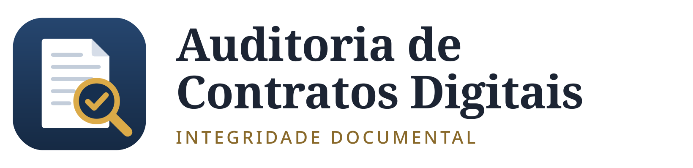
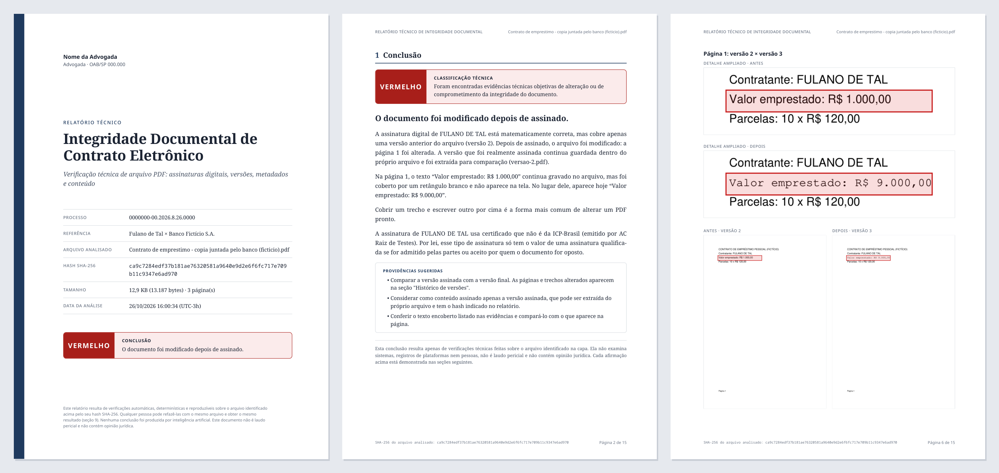

<p align="center">
  <picture>
    <source media="(prefers-color-scheme: dark)" srcset="docs/logo-escuro.png">
    
  </picture>
</p>

<p align="center">
  <b>Relatório técnico de integridade para contratos eletrônicos em PDF</b><br>
  Assinaturas digitais · versões escondidas · texto apagado · metadados · ICP-Brasil
</p>

---

## O que é

Um programa que examina um contrato em PDF, em especial contratos bancários e
documentos assinados eletronicamente, e gera um **relatório técnico pronto
para juntar ao processo**. O relatório responde à pergunta que importa:

> **Este arquivo foi alterado? Se foi, onde, quando e como se sabe disso?**

O relatório começa por uma **conclusão em linguagem simples**, que qualquer
pessoa entende sem conhecimento técnico. Em seguida vêm os pontos que levaram a
ela, cada um demonstrado com as evidências extraídas do próprio arquivo.

<p align="center"></p>
<p align="center"><sub>Exemplo com contrato fictício: o valor de R$ 1.000,00 foi coberto por um retângulo branco e reescrito como R$ 9.000,00 depois da assinatura.</sub></p>

## O que ele descobre

| Pergunta | Como o programa responde |
|---|---|
| A assinatura digital é verdadeira? | Recalcula o hash do conteúdo assinado e confere com o registrado na assinatura. Confere a assinatura com a chave do certificado. |
| O documento foi mexido depois de assinado? | Compara o que a assinatura cobre com o arquivo inteiro e classifica o que foi acrescentado depois (nova assinatura, carimbo do tempo, formulário, ou alteração de conteúdo). |
| O certificado é da ICP-Brasil? | Monta a cadeia até a AC Raiz Brasileira (v1 a v13), lê a política de certificação e extrai CPF/CNPJ do certificado. |
| Qual era o documento original? | Um PDF pode guardar versões anteriores dentro dele. O programa separa cada uma, calcula seu hash e entrega cada versão como arquivo separado. |
| O que mudou entre as versões? | Compara página a página, destaca em vermelho as regiões diferentes, mostra o detalhe ampliado e lista o texto acrescentado e removido. |
| Há texto apagado e reescrito? | Encontra texto que continua gravado no arquivo, mas foi coberto por um retângulo ou imagem desenhado por cima. |
| O arquivo passou por editor de PDF? | Lê os metadados (Info e XMP), aponta datas impossíveis, divergências e programas de edição (iLovePDF, Smallpdf etc.). |
| O hash da trilha de auditoria confere? | Encontra no texto todos os valores com formato de hash e confere com o arquivo, cada versão e cada anexo. |
| Há algo escondido ou ativo? | JavaScript, ações automáticas, arquivos anexados, camadas e anotações ocultas. |

## Como funciona

O programa segue sempre os mesmos passos, na mesma ordem:

1. **Identifica o arquivo** pelo hash SHA-256 e SHA-512, que é a sua "impressão digital".
2. **Separa as versões** gravadas dentro do PDF (atualizações incrementais).
3. **Valida cada assinatura** com os certificados oficiais da ICP-Brasil, sem acessar a internet.
4. **Compara as versões** renderizando cada página como imagem e comparando pixel a pixel e pelo texto.
5. **Examina o conteúdo:** texto encoberto, código, anexos e elementos ocultos.
6. **Lê os metadados** e os hashes citados no texto.
7. **Aplica as regras** do [catálogo](auditoria_contratos/regras.yaml) a cada resultado e classifica o documento.
8. **Escreve a conclusão** juntando as frases das regras que se aplicaram, com os dados do caso (nome do signatário, página, trecho de texto).
9. **Gera o relatório** em PDF e HTML, os dados em JSON e um arquivo com o hash de tudo o que foi gerado.

### Princípios

- **Nenhuma conclusão é produzida por inteligência artificial.** Tudo é regra fixa
  aplicada aos bytes do arquivo. A conclusão em linguagem simples também é montada
  por regras, a partir dos achados.
- **Reprodutível.** O mesmo arquivo produz o mesmo resultado. O relatório ensina a
  conferir o hash e a extrair as versões anteriores com comandos do próprio Windows,
  Linux ou macOS.
- **Transparente.** Cada achado indica a regra aplicada, o resultado, o que significa
  e as evidências.
- **Não é laudo pericial** e não contém opinião jurídica.

### Classificação

| | Significado |
|---|---|
| 🟢 **VERDE** | Nenhuma inconsistência técnica encontrada nas verificações realizadas. |
| 🟡 **AMARELO** | Inconsistências que merecem análise: sem assinatura digital, certificado fora da ICP-Brasil, edição sem assinatura, texto encoberto. |
| 🔴 **VERMELHO** | Evidência objetiva de alteração: o conteúdo assinado não confere, ou o documento foi alterado depois de assinado. |

## Instalação

Requer Python 3.11 ou mais recente.

**Linux**

```bash
git clone https://github.com/Vangl-dev/audit-contratos-digitais
cd audit-contratos-digitais
./instalar.sh
```

O instalador cria o ambiente do programa, o atalho no **menu de aplicativos** e,
no KDE, o submenu no **Dolphin**.

**Windows**

O relatório em PDF usa o WeasyPrint, que no Windows precisa do GTK: siga
<https://doc.courtbouillon.org/weasyprint/stable/first_steps.html#windows>.
Depois, dê dois cliques em `instalar.bat`.

## Como usar

**Pelo Dolphin:** clique com o botão direito sobre o PDF e escolha
**Auditoria de Contratos Digitais**:

- *Gerar relatório de integridade*: gera o relatório e já abre o PDF.
- *Abrir na janela*: abre a janela com o arquivo escolhido, para preencher o número do processo.

**Pelo menu de aplicativos:** abra *Auditoria de Contratos Digitais*, arraste o
PDF para a janela, preencha o processo (opcional) e clique em *Gerar relatório*.

**Pelo terminal:**

```bash
./abrir.sh contrato.pdf --processo "0000000-00.2026.8.26.0000" --abrir
```

### O que é gerado

O relatório é salvo **na mesma pasta do PDF analisado**, numa pasta
`Relatorio-integridade-<nome>-<data>` com:

| Arquivo | Conteúdo |
|---|---|
| `relatorio.pdf` | o relatório para juntar ao processo |
| `relatorio.html` | o mesmo relatório para abrir no navegador |
| `dados.json` | todos os dados extraídos, em formato estruturado |
| `versoes/versao-N.pdf` | cada versão anterior do arquivo, extraída byte a byte |
| `HASHES-SHA256.txt` | hash de cada arquivo gerado e do arquivo analisado |

### Seus dados na capa

Na janela, clique em **Meus dados…** para informar nome, OAB, escritório, contato,
cidade e logotipo. Eles ficam no arquivo `perfil.yaml`, que **não vai para o GitHub**.

## Certificados da ICP-Brasil

A pasta [`confianca/icp-brasil`](confianca/icp-brasil) traz os certificados oficiais
das ACs da ICP-Brasil. Para atualizar:

```bash
.venv/bin/python scripts/baixar_icp_brasil.py
```

As raízes são baixadas do ITI por HTTPS verificado e conferidas com as do pacote
oficial. O [`MANIFESTO.txt`](confianca/icp-brasil/MANIFESTO.txt) registra a data, a
origem e o hash de cada raiz. Certificados de outras plataformas podem ser colocados
em `confianca/adicionais/`.

## Como salvar as alterações no GitHub

Salvar no GitHub tem dois passos: **registrar** as mudanças no seu computador
(*commit*) e **enviar** para o site (*push*).

### Pelo VS Code (mais fácil)

1. Abra a pasta `audit-contratos-digitais` no VS Code.
2. Clique no ícone de **Controle do Código-Fonte** na barra lateral esquerda (o
   desenho de três bolinhas ligadas), ou tecle `Ctrl+Shift+G`.
3. Confira a lista de arquivos alterados. **Nenhum PDF de cliente nem o
   `perfil.yaml` deve aparecer ali.** Se aparecer, pare e veja a seção abaixo.
4. Escreva no campo de mensagem o que mudou, por exemplo: `Ajusta texto da conclusão`.
5. Clique em **Confirmar** (*Commit*). Se o VS Code perguntar se quer incluir todos
   os arquivos, responda **Sim**.
6. Clique em **Sincronizar alterações** (*Sync Changes*) para enviar ao GitHub.

### Pelo terminal

```bash
cd ~/Projetos/audit-contratos-digitais
git status                      # 1. confira o que mudou
git add -A                      # 2. inclui todas as mudanças
git commit -m "O que mudou"     # 3. registra com uma mensagem
git push                        # 4. envia ao GitHub
```

Se o `git push` pedir senha, use um **token** do GitHub e não a senha da conta:
*GitHub → Settings → Developer settings → Personal access tokens*.

### O que nunca vai para o GitHub

O repositório é **público**. O arquivo [`.gitignore`](.gitignore) impede o envio de:

- `perfil.yaml` (seu nome, OAB, contato);
- `relatorios/` e `casos/`;
- qualquer PDF solto na raiz do projeto;
- certificados de `confianca/adicionais/`.

Mesmo assim, **sempre confira a lista antes de confirmar** (passo 3 acima ou
`git status`). Os relatórios do dia a dia são salvos ao lado do PDF analisado,
fora desta pasta, e por isso não correm esse risco.

## Limitações

- A **revogação** dos certificados não é consultada (a análise roda sem internet). O
  relatório indica o [Validador do ITI](https://validar.iti.gov.br) para isso.
- As trilhas de auditoria de cada plataforma (DocuSign, Clicksign, ZapSign etc.)
  ainda não são lidas de forma específica; os hashes citados nelas são conferidos.
- O programa analisa **um arquivo por vez**; a comparação entre duas cópias (por
  exemplo, a juntada pelo banco e a do cliente) é a próxima etapa.

## Para quem for mexer no código

```bash
.venv/bin/python -m pytest        # testes (usam apenas PDFs fictícios gerados na hora)
```

```
auditoria_contratos/
  auditoria.py          executa as verificações e classifica
  conclusao.py          conclusão em linguagem simples (por regras)
  documento.py          leitura do arquivo e separação das versões
  regras.yaml           catálogo de regras (texto que vai para o relatório)
  verificacoes/
    assinaturas.py      assinaturas digitais (pyHanko)
    versoes.py          comparação entre versões
    conteudo.py         texto encoberto, conteúdo ativo, oculto e anexos
    metadados.py        Info e XMP
    hashes.py           hashes citados no texto
  relatorio/            modelo, estilo e fontes do relatório
  recursos/             ícone do programa
  interface.py          janela
confianca/              certificados de confiança (ICP-Brasil)
scripts/                baixar certificados, instalar atalhos
tests/                  testes com PDFs fictícios
docs/                   logo e imagens deste README
```
